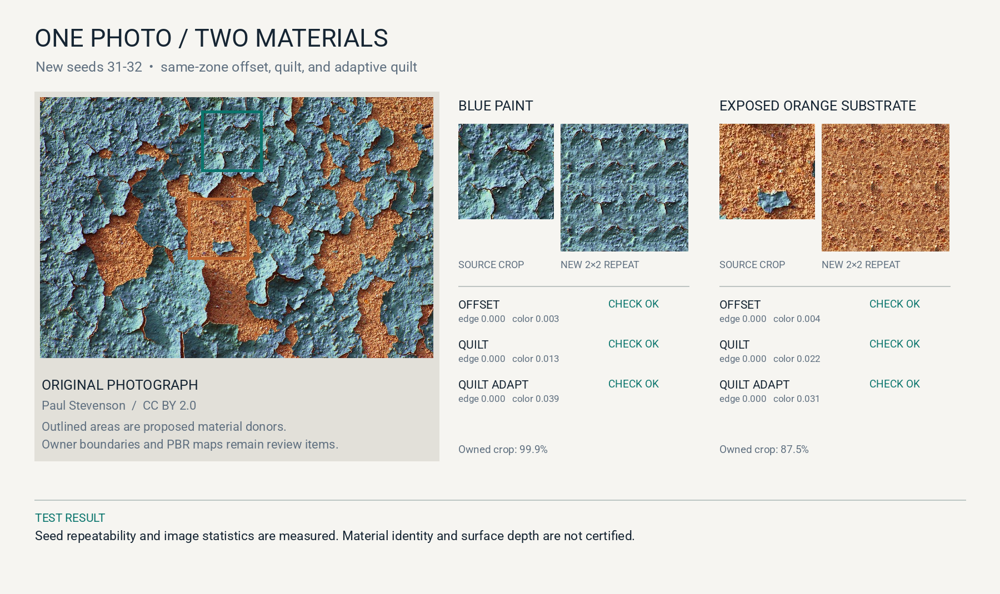
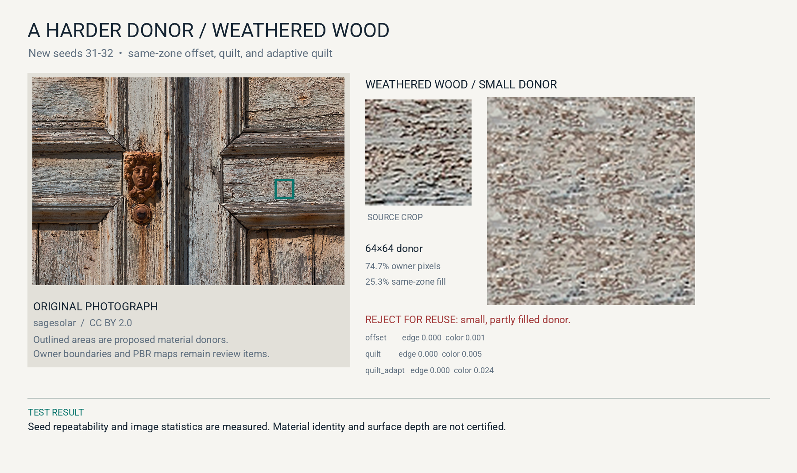
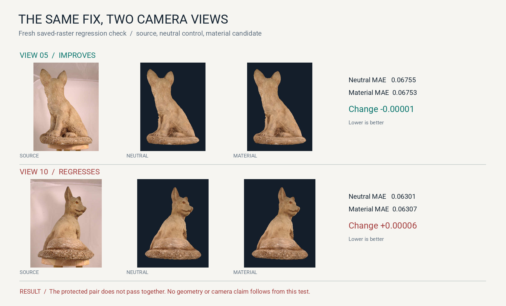

# New Argus controls · 24 October 2026

Three new visual receipts use preserved inputs. The material outputs are new
seeded candidates. The fox result is a new analysis of saved camera rasters,
not a new render or reconstructed mesh. [Download the machine-readable receipt](../assets/new-work-20261024/report.json).

## One photograph, two material donors

From one peeling-paint photo, Argus kept the proposed blue paint and exposed
orange substrate as separate zones. Each received offset, quilt and adaptive
quilt variants at new seeds 31 and 32. The twelve generated rasters are distinct
between seeds, reproduce exactly with the same seed, and meet the predeclared
checks for paired-edge RGB MAE ≤0.05, median-color difference ≤0.08, and
gradient-energy ratio 0.65–1.35. The image shows seed 32 adaptive quilt as a
2×2 repeat for each zone. These are **appearance candidates**; source ownership,
lighting separation, height and normals have not been certified here.

The blue exemplar has 99.86% proposed-owner coverage; the orange exemplar has
87.45%. Empty pixels were filled from the nearest proposed same-zone pixel
before remixing, so a neat seam is not proof of clean segmentation.

## The control that looks tempting but fails the reuse decision

The weathered-wood proposal also passes all six narrow repeatability and image
statistic checks. We **reject it for material reuse**: its donor is just 64×64,
only 74.73% of pixels carry the proposed owner, and 25.27% must be filled. A
larger source-supported patch is the next test. This is why a clean 2×2 repeat
cannot be the whole material qualification.

## The same saved fox asset across views

We recomputed RGB mean absolute error on the saved twelve view rasters within
each packaged owner mask. Under **this exact same-grid contract**, the material
candidate improves 5 of 12 views. View 05 improves by roughly 0.00001 on the
0–1 RGB scale; view 10 worsens by roughly 0.00006. The protected pair fails the
joint check. Differences are small, but the direction matters. The earlier
full-resolution local report used a different mask/metric contract and found
six improved views; these counts must not be merged. Neither saved-raster
comparison independently certifies photographic camera registration, which
remains an open upstream finding.

## How to read the receipt

- **Tested today:** 18 new material rasters from three proposed zones; same-seed
  determinism, two-seed variation, seam/color/gradient statistics; saved-raster
  fox comparison across all twelve packaged views.
- **Accepted at this scope:** technical repeat checks on all 18 variants.
- **Rejected or unresolved:** the small wood donor for reuse; the fox material
  candidate as a protected-view improvement; zone boundaries, measured PBR,
  capture-light fit and camera calibration.
- **Next discriminating input:** a larger weathered-wood donor and a fox
  correction that improves view 10 without erasing view 05's gain.

### Sources and adaptation credits

- Peeling-paint photo: [Paul Stevenson, *Abstract – Peeling Paint*](https://www.flickr.com/photos/53496815@N00/424540015/), [CC BY 2.0](https://creativecommons.org/licenses/by/2.0/). Cropped, segmented and remixed for the first panel.
- Weathered-door photo: [sagesolar, *The face in the door*](https://www.flickr.com/photos/62356799@N06/15940045866/), [CC BY 2.0](https://creativecommons.org/licenses/by/2.0/). Cropped, segmented and remixed for the second panel.
- Fox photographs: [John Davies, fox photogrammetry set](https://github.com/john-davies/Photogrammetry-examples/tree/master/Fox), [CC BY-SA 4.0](https://creativecommons.org/licenses/by-sa/4.0/). The third panel adapts his photos and is shared under CC BY-SA 4.0. Argus's saved renders and measured annotations are our additions; no endorsement is implied.
