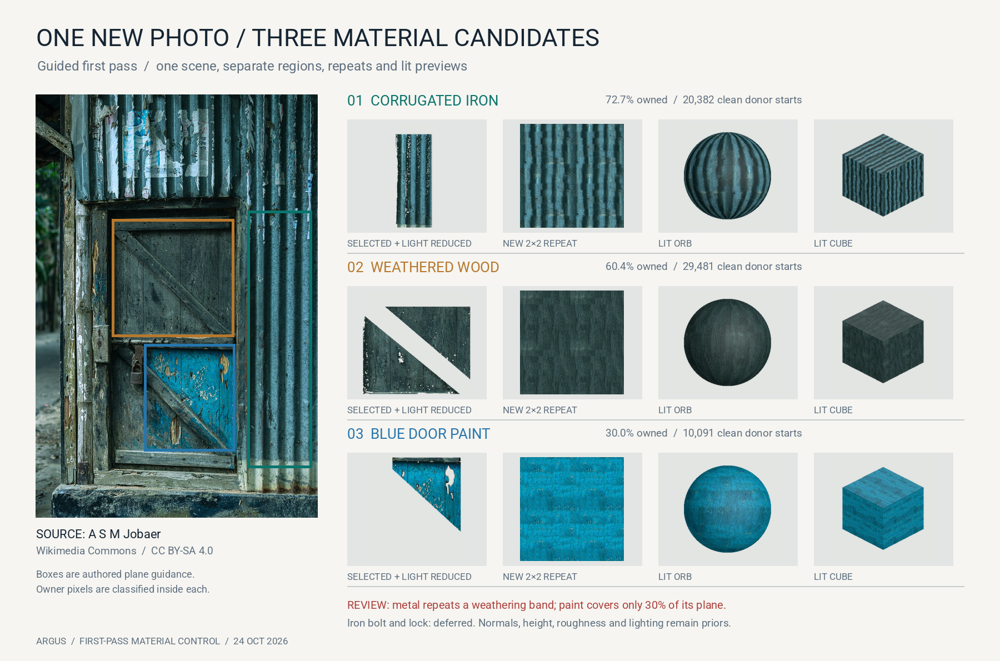

# New Argus controls · 24 October 2026

Four visual receipts cover new seeded material candidates, an untuned scene
photo, and a new analysis of saved fox camera rasters. The fox result is not a
new render or reconstructed mesh. [Download the seeded-remix receipt](../assets/new-work-20261024/report.json).

## One photograph, two material donors

From one peeling-paint photo, Argus kept the proposed blue paint and exposed
orange substrate as separate zones. Each received offset, quilt and adaptive
quilt variants at new seeds 31 and 32. The twelve generated rasters are distinct
between seeds, reproduce exactly with the same seed, and meet the predeclared
checks for paired-edge RGB MAE ≤0.05, median-color difference ≤0.08, and
gradient-energy ratio 0.65–1.35. The image shows seed 32 adaptive quilt as a
2×2 repeat for each zone. These are **appearance candidates**; source ownership,
lighting separation, height and normals have not been certified here.

The blue exemplar has 99.86% proposed-owner coverage; the orange exemplar has
87.45%. Empty pixels were filled from the nearest proposed same-zone pixel
before remixing, so a neat seam is not proof of clean segmentation.

## The control that looks tempting but fails the reuse decision

The weathered-wood proposal also passes all six narrow repeatability and image
statistic checks. We **reject it for material reuse**: its donor is just 64×64,
only 74.73% of pixels carry the proposed owner, and 25.27% must be filled. A
larger source-supported patch is the next test. This is why a clean 2×2 repeat
cannot be the whole material qualification.

## A new scene with four visible material families

We selected a [new, freely reusable scene photograph by A S M Jobaer](https://commons.wikimedia.org/wiki/File:Rustic_wooden_door_in_a_corrugated_metal_wall.jpg), licensed [CC BY-SA 4.0](https://creativecommons.org/licenses/by-sa/4.0/). It contains corrugated iron, weathered wood, blue door paint, and a small iron bolt and padlock. The 960×1440 source thumbnail, authored plane rectangles, positive examples and exclusions were frozen before the first run. The method classifies pixels only **inside those guided planes**; this is a test of regional extraction, not automatic object detection.

The first pass generated three separate UV material candidates. Across metal, wood and paint respectively, the measured proposed-owner coverage is **72.74%, 60.37%, and 30.04%**. Each uses 64×64 fully owned donor patches; independent checks confirmed every selected donor stays inside its owner mask, all three export ZIPs pass integrity checks, and the UV OBJ files contain faces. The panel shows each source-derived region, a 2×2 repeat, and lit orb/cube previews. The previews use estimated single-image normals and authored roughness.

The limitations are visible too. The metal repeat carries a broad weathering band, and its zero metallic map is a placeholder, so we do **not** accept it as a finished iron PBR material. The blue-paint owner covers only 30.04% of its guided plane. The isolated bolt and padlock have no defensible repeat donor, so they are **deferred** rather than merged into the wood or paint.

[Frozen first-pass guidance](../assets/new-work-20261024/commons-door/frozen-spec.json) · [Full result and checks](../assets/new-work-20261024/commons-door/first-pass-report.json) · Download review candidates: [metal](../assets/new-work-20261024/commons-door/corrugated_wall-material.zip), [wood](../assets/new-work-20261024/commons-door/weathered_wood-material.zip), [blue paint](../assets/new-work-20261024/commons-door/blue_paint-material.zip). The derived image and material outputs from this photo are shared under CC BY-SA 4.0, with changes consisting of cropping, guided segmentation, lighting reduction, repeat synthesis, UV mesh and estimated PBR maps. The author does not endorse Argus.

## The same saved fox asset across views

We recomputed RGB mean absolute error on the saved twelve view rasters within
each packaged owner mask. Under **this exact same-grid contract**, the material
candidate improves 5 of 12 views. View 05 improves by roughly 0.00001 on the
0–1 RGB scale; view 10 worsens by roughly 0.00006. The protected pair fails the
joint check. Differences are small, but the direction matters. The earlier
full-resolution local report used a different mask/metric contract and found
six improved views; these counts must not be merged. Neither saved-raster
comparison independently certifies photographic camera registration, which
remains an open upstream finding.

## How to read the receipt

- **Tested today:** 18 new material rasters from three proposed zones; a new
  guided three-material scene extraction with donor, ZIP and OBJ checks; and a
  saved-raster fox comparison across all twelve packaged views.
- **Accepted at this scope:** technical repeat checks on all 18 variants.
- **Rejected or unresolved:** the small wood donor for reuse; the corrugated
  metal as finished PBR; the isolated iron hardware; the fox material candidate
  as a protected-view improvement; zone boundaries, measured PBR, capture-light
  fit and camera calibration.
- **Next discriminating input:** a larger weathered-wood donor and a fox
  correction that improves view 10 without erasing view 05's gain.

### Sources and adaptation credits

- Peeling-paint photo: [Paul Stevenson, *Abstract – Peeling Paint*](https://www.flickr.com/photos/53496815@N00/424540015/), [CC BY 2.0](https://creativecommons.org/licenses/by/2.0/). Cropped, segmented and remixed for the first panel.
- Weathered-door photo: [sagesolar, *The face in the door*](https://www.flickr.com/photos/62356799@N06/15940045866/), [CC BY 2.0](https://creativecommons.org/licenses/by/2.0/). Cropped, segmented and remixed for the second panel.
- Corrugated wall and wooden door photo: [A S M Jobaer, *Rustic wooden door in a corrugated metal wall*](https://commons.wikimedia.org/wiki/File:Rustic_wooden_door_in_a_corrugated_metal_wall.jpg), [CC BY-SA 4.0](https://creativecommons.org/licenses/by-sa/4.0/). The fourth panel and downloadable material candidates adapt the photograph and use the same license.
- Fox photographs: [John Davies, fox photogrammetry set](https://github.com/john-davies/Photogrammetry-examples/tree/master/Fox), [CC BY-SA 4.0](https://creativecommons.org/licenses/by-sa/4.0/). The third panel adapts his photos and is shared under CC BY-SA 4.0. Argus's saved renders and measured annotations are our additions; no endorsement is implied.
